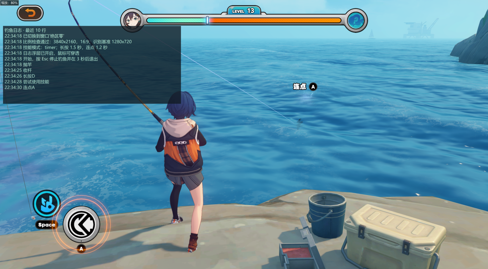
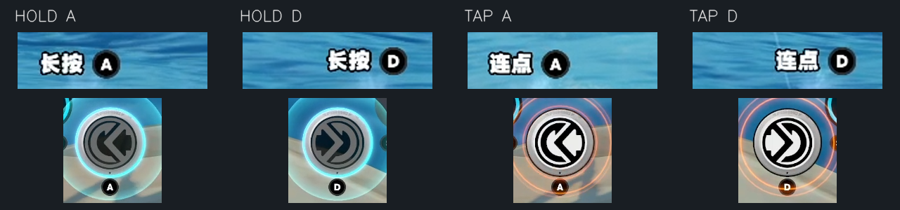
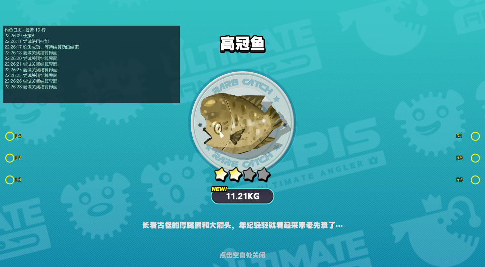

# zzz-auto-fish · Windows 窗口版


[](LICENSE)

基于图像识别的《绝区零》自动钓鱼工具：从抛竿、收杆、A/D 长按或连点，到尝试技能和关闭结算，在游戏窗口内完成一轮轮钓鱼。

本版本基于 [SmallHappyJerry/zzz-auto-fish](https://github.com/SmallHappyJerry/zzz-auto-fish) 的窗口钓鱼代码持续改进，统一使用 `fish.py` 作为入口，加入分辨率归一化、画面反馈控制、十行日志浮层、Esc 停止、项目内独立环境和 EXE 打包。旧项目中的 `近岸.py`、`石礁.py` 等命令不适用于本目录。



*使用者提供的实际运行截图。截图中的日志来自此前版本；当前默认技能策略以本文和源码配置为准。图片排版缩放不代表游戏内 UI 缩放。公开展示图已裁去账号信息所在的底部区域。*

> **重要变化：计时不是松开 A/D 的截止时间。** 长按 1.5 秒、连点 1.2 秒是最早尝试技能的时间；大鱼的操作窗口更长时，会继续控制。发送空格后也会检查画面，操作仍在则保持长按或恢复连点，而不是停在等待状态。

## 目录

- [运行条件](#运行条件)
- [直接使用 EXE](#方式一直接使用-exe)
- [一键准备环境](#方式二一键准备项目内环境)
- [手动安装与已有环境](#方式三已有-python手动使用-requirementstxt)
- [操作策略与参数](#操作策略与参数)
- [日志与故障排查](#日志与故障排查)
- [自行打包 EXE](#自行打包-exe)
- [GitHub Actions](#github-actions)
- [开发与素材维护](#开发与素材维护)
- [鸣谢与来源](#鸣谢与来源)
- [许可证](#许可证)

## 运行条件

| 项目 | 要求 / 范围 |
| --- | --- |
| 系统 | Windows 10 / 11，x64 |
| 源码环境 | Python 3.12 x64，包含 Tcl/Tk；一键脚本使用固定版本便携 Python |
| 游戏语言 | 当前识别素材来自简体中文界面 |
| 画面比例 | 游戏客户区为 16:9；兼容 1366×768 的取整误差 |
| 分辨率 | 自动按高度归一化识别；1280×720、1600×900、1920×1080、2560×1440、3840×2160 等 16:9 尺寸 |
| 显示模式 | 建议窗口 / 无边框全屏；独占全屏可能不显示日志浮层 |
| 输入与焦点 | 英文输入法，保持游戏在前台且不被遮挡；窗口失焦会停止操作 |
| 图像设置 | 建议关闭 HDR、使用与素材接近的默认字体和 UI 比例；其他设置需要重新验证 |

检查的是**游戏客户区**，不是显示器比例。其他比例显示器也可开 16:9 游戏窗口；运行中改成不支持的比例会停止。不同钓点只要界面布局一致便可尝试，但不承诺所有字体、鱼种、弹窗或自定义 UI 都已适配。

## 方式一：直接使用 EXE

1. 在 [Releases](https://github.com/FlowPeakFish/zzz-auto-fish/releases) 下载 `ZZZAutoFish.exe`，放到可写的独立文件夹。
2. **右键 → 以管理员身份运行**，确认 Windows 权限提示。双击也会请求管理员权限。
3. 程序自动切换到游戏，随后开始识别操作。
4. 按 **Esc**：停止所有脚本操作、释放按住的 A/D，显示 3、2、1 秒倒计时，然后关闭浮层并退出。

无需安装 Python，无需单独下载图片。EXE 是单文件，已包含解释器、依赖和必需素材。`fish.log`、诊断目录 `debug/` 写在 EXE 所在目录，不写进临时资源目录。已有终端窗口不会被脚本强制关闭。

如果还没有发布版本，可在仓库的 **Actions → Build Windows EXE** 中运行或打开已成功的任务，在 **Artifacts** 下载 `ZZZAutoFish-windows-x64`，解压后使用里面的 EXE。Artifact 下载通常需要登录 GitHub。SHA256 文件可用于核对下载完整性。

## 方式二：一键准备项目内环境

不要求系统事先安装 Python。

1. 下载或克隆完整源码，解压到较短目录（例如 `D:\zzz-auto-fish`），避免旧依赖的 Windows 长路径限制。
2. 双击 **`setup_env.bat`**。首次安装需要网络，请等待完成提示。
3. 右键 **`start.bat` → 以管理员身份运行**。未准备环境时，启动脚本也会自动调用安装流程。

脚本会：

- 优先从南京大学镜像下载固定版本的完整便携 Python **3.12.16 x64**，下载失败依次尝试镜像备用域名和上游 GitHub。
- 校验固定的 SHA256，然后解压到 `envs/python/`。完整运行时带有日志浮层所需的 Tcl/Tk；不能用不含 Tk 的 Python embeddable 包替代。
- 从清华 PyPI 镜像读取 `requirements.txt`，把依赖安装到这份便携 Python 内。
- 把下载缓存和安装临时文件放在 `envs/` 内，执行不触碰游戏的资源自检。

**不会调用系统安装器，不修改系统 PATH，不注册 Python，也不使用用户目录中的 Python 包。** 设置的环境变量只对本次脚本及子进程有效。不需要时，退出程序后删除整个项目即可；只想重装环境，可删除 `envs/` 再运行准备脚本。便携环境移动路径后若有异常，重建 `envs/`。

常用命令（PowerShell，在项目目录执行）：

```powershell
# 一键准备，不在末尾暂停
.\setup_env.bat --no-pause

# 临时换用其他 PyPI 镜像，不修改全局 pip 配置
powershell -NoProfile -ExecutionPolicy Bypass -File .\scripts\setup_env.ps1 -IndexUrl https://mirrors.aliyun.com/pypi/simple/
```

下载地址和固定校验值在 `scripts/setup_env.ps1`。镜像异常时可稍后重试，也可使用下面的手动方式。

## 方式三：已有 Python，手动使用 requirements.txt

建议 Python **3.12 x64**，须包含 `tkinter`。推荐创建项目内虚拟环境：

```powershell
# 使用你已有的 Python 创建环境；也可把 python 换成解释器的完整路径
python -m venv .\envs\venv

# 不需要激活环境，直接使用这份解释器
.\envs\venv\Scripts\python.exe -m pip --isolated install --index-url https://pypi.tuna.tsinghua.edu.cn/simple --cache-dir .\envs\pip-cache -r .\requirements.txt
.\envs\venv\Scripts\python.exe -B .\fish.py --self-check
```

安装成功后，右键运行 `start.bat`。它优先使用 `envs/venv/`，其次使用一键安装的 `envs/python/`。

如果**已经在自己的环境中通过 requirements.txt 配置好了依赖**，不必再安装或创建环境，直接运行：

```powershell
python .\fish.py

# 或指定已有的解释器
.\start.bat "D:\Python312\python.exe"
```

此时使用的是你自己的环境，依赖的安装和卸载由该环境自行管理；项目不会自动改动它。Tkinter 不是 requirements 中的 pip 包；若 `import tkinter` 失败，请换用包含 Tcl/Tk 的完整 Python。

## 操作策略与参数

### 长按、连点和技能确认



操作文字（长按 / 连点）和按键字母（A / D）分开识别。大按钮的“按下”和“松开”图片是两种外观状态，和长按、连点模式不是同一概念。

1. 识别到操作提示和对应按钮后，开始长按或连点。
2. 达到最早尝试时间后，默认还要确认蓝色技能图标亮起；未就绪时继续控制。
3. 尝试空格时不提前松开长按。连点会留出短暂的技能确认窗口。
4. 画面仍显示当前操作时，保持长按或恢复连点，并按重试间隔再次尝试技能。
5. 按钮和对应提示都持续消失，或明确出现下一种操作、进入结算、停止程序时，释放旧按键。

这套策略根据画面反馈延长控制时间，**不能预测“机会消失前最后一瞬”**。长按和连点的最早尝试时间可按实际鱼种与延迟调整，不要把它们当成硬停止时间。

| 参数（`fish.py` 顶部） | 默认值 | 含义 |
| --- | --- | --- |
| `HOLD_SKILL_DELAY_SECONDS` | `1.5` | 长按最早尝试技能的时间 |
| `TAP_SKILL_DELAY_SECONDS` | `1.2` | 连点最早尝试技能的时间 |
| `SKILL_TRIGGER_MODE` | `timer_and_ready` | 满最短时间且蓝色技能亮起才尝试 |
| 可选 `timer` 模式 | — | 到最短时间就尝试；同样会确认画面并继续未结束的操作 |
| `SKILL_CONFIRM_SECONDS` | `0.25` | 空格后的短暂确认窗口；此时保持长按，暂缓新的连点 |
| `SKILL_RETRY_SECONDS` | `0.8` | 两次技能尝试之间的最小间隔 |
| `OPPORTUNITY_MISSING_GRACE_SECONDS` | `0.35` | 按钮和对应文字都不见后，等待多久确认结束 |
| `SHOW_LOG_OVERLAY` | `True` | 显示左上角最近十行日志 |

截图、识别和输入按帧进行，实际时刻可能略晚于参数值。源码参数改动后需要重启；EXE 使用打包时的配置，改动后需重新打包。

### 结算关闭



*R / L 为右侧 / 左侧，数字表示尝试顺序。标记仅用于文档说明，不参与识别。*

识别到“点击空白处关闭”后先等待 1.5 秒，再在左右外缘交替点击，高度在画面的 50%、58%、66% 之间轮换。点击未关闭时每 1.5 秒重试；每轮只记录一次“钓鱼成功”，确认结算消失后再开始下一轮。未知的新物品弹窗可能仍需补充适配或手动处理。

### 停止程序

在游戏内按 **Esc** 即可停止，无需切回终端：

- 立即停止发送新操作，并释放脚本按住的 A/D；Esc 自身也会传给游戏。
- 显示“停止钓鱼”和 3、2、1 秒倒计时；倒计时不再截图或操作游戏。
- 关闭浮层和监听线程，整个 Python / EXE 程序退出。已有终端窗口不被强制关闭。

Ctrl+C 也可停止；异常、失焦或不支持的画面比例会释放按键并退出。

## 日志与故障排查

| 文件 | 作用 |
| --- | --- |
| `fish.log` | 完整日志；约 500 KB 后轮换，额外保留 2 份 |
| `debug/last_prompt.png` | 最近一次识别不确定的操作提示截图 |
| `debug/last_prompt_scores.json` | 长按 / 连点、A / D 的独立分数 |
| `debug/last_cast_region.png` | 等待抛竿时的提示区域 |
| `debug/last_cast_score.json` | 抛竿分数和门槛 |
| `debug/last_reel_region.png` | 等待上钩时的按钮区域 |
| `debug/last_reel_scores.json` | 圆形内核匹配分数、紫色比例和触发门槛 |

- **长按 / 连点中途停止**：确认使用的是新版 EXE，日志默认策略应为 `timer_and_ready`。若记录“操作机会已结束”但文字仍在，请提供当时完整 PNG、诊断图和日志。
- **等待抛竿分数是 0**：过渡画面中只有天空属于正常等待；持续可见文字却不操作时才需要检查区域、字体和图像设置。抛竿识别会轻微平滑文字掩膜，以兼容非整数分辨率缩放造成的边缘差异；当前门槛为 0.90，同时避免把相似的上钩提示误判为抛竿。
- **换钓点后无法收杆 F**：收杆模板现在只保留按钮内核，圆形掩膜排除水面与外圈光效，并检查紫色鱼钩是否亮起，不需要为每种水色重新截图。若仍失败，请提供 `last_reel_region.png` 和 `last_reel_scores.json`，不要只降低门槛。
- **发送空格但技能未用出**：现在会保持或恢复 A/D 并等待后续机会，不把空格当成成功信号。若蓝色技能明显亮起却长期不尝试，请提供截图。
- **持续无法关闭结算**：确认管理员权限和游戏焦点，再提供完整结算截图。新的物品、首次获得或其他弹窗可能与现有素材不同。
- **看不到浮层**：先试无边框全屏或窗口模式；普通 Windows 置顶浮层不保证覆盖独占全屏。
- **一键安装失败**：检查镜像和网络，避免过长目录，重新运行 `setup_env.bat`。不要把精简的 Python embeddable 包直接代替完整运行时。

自检不会激活游戏、截图屏幕或发送按键，还会核对图片目录是否存在未使用文件：

```powershell
python .\fish.py --self-check
```

## 自行打包 EXE

在包含 Tcl/Tk 的 Windows x64 Python 3.12 环境执行：

```powershell
python -m pip install -r .\requirements-build.txt
python .\scripts\build_exe.py
```

若使用一键环境，把上面的 `python` 换成 `.\envs\python\python.exe`。生成：

```text
dist/
  ZZZAutoFish.exe
  ZZZAutoFish.exe.sha256
  README.md
  LICENSE
  NOTICE.md
  docs/images/
```

PyInstaller 会收集 Tcl/Tk、OpenCV、依赖和 `image/` 素材。使用单文件模式并嵌入管理员权限清单，EXE 内保留上游许可证和来源说明。构建产物和缓存不会进入 Git。

## GitHub Actions

工作流：`.github/workflows/build-windows.yml`。

- 推送到 `main`、针对 `main` 的 PR、或手动点击 **Run workflow**：在 Windows 上自检并打包，上传保留 30 天的构建产物。
- 推送 `v*` 标签（例如 `v1.0.0`）：构建成功后自动创建或更新 GitHub Release，附上可直接下载的 EXE、SHA256、LICENSE 和 NOTICE。
- 普通分支构建不发布 Release；发布任务使用仓库自带的 `GITHUB_TOKEN`，不需要额外配置个人密钥。

只有把本地文件提交并推送到 GitHub 后，线上工作流才会执行。创建标签示例：

```powershell
git tag v1.0.0
git push origin v1.0.0
```

## 开发与素材维护

```text
fish.py                    窗口定位、识别、反馈控制和入口
log_overlay.py             最近十行日志浮层
runtime_control.py         Esc 停止与输入保护
image/                     实际被加载的运行 PNG 素材
docs/images/               README 展示图，不参与图像识别
requirements.txt           运行依赖
requirements-build.txt     打包依赖
setup_env.bat / start.bat   一键准备与启动
scripts/                   安装和构建脚本
.github/workflows/         Windows 构建与标签发布
LICENSE / NOTICE.md        上游许可与来源说明
```

当前 `image/` 的 14 张 PNG 全部被代码实际加载：

| 类别 | 素材 |
| --- | --- |
| 操作模式与变体 | `hold_mode.png`、`tap_mode.png`、`prompt_hold_d.png`、`prompt_tap_d.png` |
| 按键方向 | `left_direction.png`、`right_direction.png` |
| 左右按钮的按下 / 松开 | `left_button_pressed.png`、`left_button_released.png`、`right_button_pressed.png`、`right_button_released.png` |
| 流程与技能 | `cast_prompt.png`、`reel_button.png`、`skill_ready.png`、`finish_prompt.png` |

`reel_button.png` 为 70×70 的鱼钩按钮内核；识别时使用圆形掩膜和彩色就绪检查，周围海水不参与匹配。

新增素材时应同时接入加载与识别逻辑；不使用的素材移出 `image/`，展示图放入 `docs/images/`。自检会拒绝存在未引用文件的运行素材目录，避免 reviewer 无法判断图片用途。不要把文档裁剪或标注图拿来替换识别模板。

`.gitignore` 已排除 `envs/`、`.idea/`、缓存、日志、诊断截图和构建产物。历史测试、原始样本、临时备份不随项目分发。

### 反馈与贡献

欢迎通过当前仓库的 Issues 或 PR 提供改进。请说明版本 / 提交、分辨率、窗口模式、游戏语言、字体、HDR 和复现步骤，并附原始 PNG 与相关日志。公开前遮挡 UID 和个人信息。提交前运行自检，确认未加入环境、日志、调试图或未引用素材。

## 鸣谢与来源

- [**SmallHappyJerry / zzz-auto-fish**](https://github.com/SmallHappyJerry/zzz-auto-fish)：上游项目及原始窗口钓鱼实现。[原项目展示视频](https://www.bilibili.com/video/BV1k8ApeaELT/) 作为历史参考，不代表本版本全部行为。
- B站 [**the南篱**](https://space.bilibili.com/436320262/)：正是在他的内容和思路启发下，才诞生了这个作品。虽然实现与重构过程中借助了 AI 辅助，仍然感谢原作者与分享者带来的启迪、路线指引和经验分享。
- B站芝士乌龙丶：对上游项目问题的发现与反馈。
- 提供实际运行截图、日志和鱼种反馈的使用者，以及 Python、OpenCV、PyAutoGUI、PyDirectInput、PyGetWindow、PyInstaller 等项目的维护者。

鸣谢不代表上述创作者参与了本版本维护或提供运行保证。更多来源说明见 [NOTICE.md](NOTICE.md)。

## 许可证

代码沿用上游的 [MIT 许可证](LICENSE)，保留 `Copyright (c) 2025 SmallHappyJerry` 及完整许可文本。分发源码和 EXE 时均保留 LICENSE / NOTICE；EXE 内也包含这两份说明。不会额外加入与 MIT 冲突的“禁止商用”代码许可限制。

游戏截图、角色、界面和图标等内容的权利归相应权利人所有；代码许可证不代表对这些内容额外授权。本项目为非官方工具，使用前请确认适用的游戏及平台规则。软件依照 MIT 的“按原样、无担保”条款提供。

便携 Python 来自 [Python Standalone Builds](https://github.com/astral-sh/python-build-standalone)，优先经 [南京大学镜像](https://mirrors.nju.edu.cn/) 下载；依赖使用 [清华 PyPI 镜像](https://mirrors.tuna.tsinghua.edu.cn/help/pypi/)。第三方组件仍适用各自许可证。
